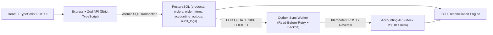

# RoastLedger — POS, Inventory & Accounting Sync

> **Live Demo:** https://roastledger-pos-sync.onrender.com *(hosted on Render Free Tier — initial wake-up after inactivity takes ~30–50s)*

A full-stack specialty coffee **Point-of-Sale (POS), Inventory, and Accounting Reconciliation** platform built with **TypeScript, React, Node.js/Express, Zod, and PostgreSQL**.

Designed to run locally in **two commands with zero Docker or database installation** via embedded PostgreSQL (`@electric-sql/pglite`), while following production architecture patterns used when integrating business apps with accounting systems such as **MYOB** or **Xero**.

---

## Architecture Overview



### Key Engineering Highlights
- **Strict TypeScript + Runtime Boundary Validation:** `"strict": true` and `"noUncheckedIndexedAccess": true` across server and client, with **Zod** validating all incoming HTTP payloads.
- **Product CRUD with Smart Delete / Archive:** Full create, update, restock, delete, and restore lifecycle (`POST/PATCH/DELETE /api/products`, `POST /api/products/:id/restore`). Price updates never mutate historical `order_items` snapshots, and deleting a sold product safely archives (`is_active = false`) instead of breaking financial/audit integrity.
- **ACID Inventory & Checkout Transactions:** Stock deduction (`WHERE id = $2 AND is_active = true AND stock_qty >= $1` + `CHECK (stock_qty >= 0)`), order creation, `accounting_outbox` enqueueing, and `audit_logs` happen inside **one atomic PostgreSQL transaction**—preventing overselling and partial writes.
- **Integer-Cents Accounting Math:** All prices, 10% GST calculations, cash change, and reconciliation variances use integer cents (`BIGINT`) to eliminate floating-point drift.
- **Checkout Idempotency:** Every sale carries a client-generated `idempotency_key` (`UNIQUE` in Postgres) so accidental double-clicks replay the original order without double-charging or deducting stock twice.
- **Transactional Outbox + Fault Injection:** Includes an interactive **Fault Simulator** (`504 Timeout After Commit`, `429 Rate Limit`, `400 Validation Dead-Letter`) proving **read-before-retry** recovery so a timed-out journal is never double-posted.
- **End-of-Day Reconciliation:** Compares local PostgreSQL orders against the external accounting ledger to surface `missing_in_accounting`, `amount_mismatch`, and `void_drift` exceptions.

---

## Quick Start (Zero Docker Required)

```bash
# 1. Install root, server, and client dependencies
npm run install:all

# 2. Run API (http://localhost:4000) + React UI (http://localhost:5173)
npm run dev
```

### Verification Commands
```bash
npm run typecheck   # Strict TypeScript check (server + client)
npm test            # 9 Vitest integration tests against real PostgreSQL (PGlite)
npm run build       # Production build (server + client)
npm start           # Single-service production server (serves API + React build)
```

---

## Live Cloud Deploy (One-File Render Blueprint — Free Tier)
This repository includes a ready-to-deploy [`render.yaml`](./render.yaml) Blueprint (Singapore region, zero external DB setup required):
1. Sign in to [Render](https://render.com) with GitHub.
2. Click **New + → Blueprint**, select `InstamedSquared/pos-accounting-sync`, and click **Apply**.
3. Render installs dependencies, builds both server and client, and serves the live React UI + Express API + embedded PostgreSQL on a single public HTTPS URL.

---

## Production Cloud / Azure Mapping
This architecture maps cleanly to managed cloud deployments:
- **Frontend:** Azure Static Web Apps / Cloudflare Pages
- **Backend & Worker:** Azure App Service / Container Apps
- **Database:** Azure Database for PostgreSQL (Flexible Server) or Neon PostgreSQL
- **Secrets & Monitoring:** Azure Key Vault (Managed Identity) + Application Insights
- **CI/CD:** GitHub Actions (`.github/workflows/ci.yml`) running `typecheck`, `test`, and `build` on every pull request
